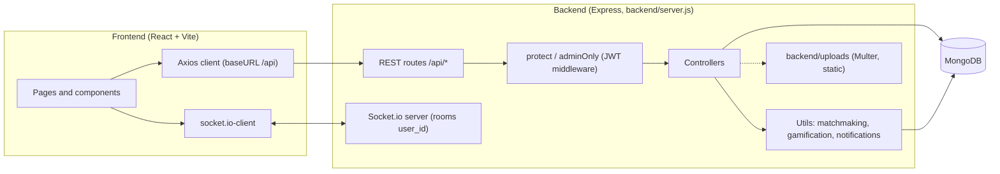

# Skill Swap Platform

A full-stack skill-exchange web application in which users teach and learn skills from each other without money. Users list skills they offer or want to learn, receive ranked match suggestions, chat in real time, schedule and complete swap sessions, review each other, and earn points and badges. An admin dashboard covers platform statistics, user reports and account suspension.

The application is built with the MERN stack (MongoDB, Express, React, Node.js) and uses Socket.io for real-time messaging.

## Problem statement

People often want to learn a skill that someone nearby already has, and can offer one of their own in return. Skill Swap Platform matches users whose offered and requested skills complement each other, and adds the pieces a barter exchange needs to work: scheduling, messaging, reviews and a trust score.

## Key features

- **Accounts and authentication**: registration and login with JWT bearer tokens and bcrypt-hashed passwords (`express-validator` checks name, email and a password of at least 6 characters).
- **Profiles**: bio, location, languages, weekly availability, offered and requested skills with levels (`beginner`, `intermediate`, `advanced`, `expert`), avatar upload, and account deletion with password confirmation.
- **Skill listings**: create, edit, delete and favourite skills. Search by MongoDB full-text index (title, description, tags) and filter by tags, location, mode (`online` / `offline` / `both`) and type (`offered` / `requested`), with pagination.
- **Matchmaking**: rule-based scoring of every other non-suspended user (see [Matchmaking score](#matchmaking-score)). The top 20 candidates are returned with human-readable reasons.
- **Sessions**: propose a session to another user, who can then accept or reject it. Either participant can cancel it, and completing it awards points.
- **Messaging**: one-to-one conversations stored in MongoDB, optional file attachments (images, PDF, DOC/DOCX, up to 5 MB) and live delivery through Socket.io rooms.
- **Reviews and trust score**: 1–5 star reviews on completed sessions (one per reviewer per session). Each review updates the reviewee's average rating and shifts their trust score by `(rating - 3) * 5`.
- **Gamification**: points for actions, milestone bonuses, four badges and a top-20 points leaderboard (see [Gamification](#gamification)).
- **Notifications**: in-app notifications for matches, session proposals and responses, cancellations, messages and badges, with read and mark-all-read actions.
- **Administration**: platform statistics, a list of all users, suspending and unsuspending users, user-submitted reports with a status workflow (`open`, `investigating`, `resolved`, `dismissed`), and a "suspicious users" view (trust score below 20, or suspended).
- **Frontend**: a React single-page app with protected and admin-only routes, plus light and dark theme and toast contexts.

## Tech stack

| Layer | Technologies |
|---|---|
| Frontend | React 18, Vite 5, React Router 6, Tailwind CSS 3, Framer Motion, lucide-react, Axios, socket.io-client |
| Backend | Node.js (ES modules), Express 4, Socket.io 4, express-validator, Multer (file uploads) |
| Database | MongoDB with Mongoose 8 |
| Auth | JSON Web Tokens (`jsonwebtoken`), `bcryptjs` |

## Architecture



- In development, the Vite dev server (port 5173) proxies `/api`, `/uploads` and `/socket.io` to the backend on port 5000 (`frontend/vite.config.js`).
- The backend also serves the built frontend from `frontend/dist`, with a catch-all route that returns `index.html`. After `npm run build`, one Node process can serve both the API and the SPA.
- Real-time chat works in two steps. The client saves a message with `POST /api/messages/:userId`, then emits `send_message`. The server relays it as `new_message` to the receiver's `user_<id>` room, which the client joins with the `join` event.

## Project structure

```
skill-swap-platform/
├── backend/
│   ├── server.js                 # Express app, Socket.io, route mounting, static frontend
│   ├── package.json
│   ├── .env.example
│   ├── seed/seed.js              # Demo data (users, skills, badges)
│   └── src/
│       ├── config/db.js          # Mongoose connection
│       ├── controllers/          # auth, user, skill, match, session, message,
│       │                         # notification, review, admin, badge
│       ├── middleware/           # auth.js (protect, adminOnly), upload.js (Multer), errorHandler.js
│       ├── models/               # User, Skill, Match, Session, Message, Notification,
│       │                         # Review, Report, Badge
│       ├── routes/               # One router per resource, mounted under /api
│       └── utils/                # matchmaking.js, gamification.js, notifications.js, generateToken.js
└── frontend/
    ├── index.html
    ├── vite.config.js            # Dev server port 5173 and backend proxy
    ├── tailwind.config.js
    └── src/
        ├── App.jsx               # Route definitions
        ├── services/api.js       # Axios instance with bearer-token interceptor
        ├── context/              # AuthContext, ThemeContext, ToastContext
        ├── components/           # Shared components, layout/ and ui/ primitives
        ├── pages/                # Home, Login, Register, Dashboard, Search, Matches,
        │                         # Messages, Sessions, Reviews, Notifications,
        │                         # Leaderboard, Profile, EditProfile, CreateSkill,
        │                         # SkillDetails, AdminDashboard
        └── lib/utils.js
```

## Getting started

### Prerequisites

- Node.js 18 or later (the `dev` script uses `node --watch`)
- A running MongoDB instance (local or remote)

### Installation

```bash
git clone https://github.com/Rewanooo22/skill-swap-platform.git
cd skill-swap-platform

# Backend
cd backend
npm install
cp .env.example .env        # then edit the values
npm run seed                # optional: wipes and loads demo data
npm run dev                 # API on http://localhost:5000

# Frontend (in a second terminal, from the repository root)
cd frontend
npm install
npm run dev                 # app on http://localhost:5173
```

On Windows, use `copy .env.example .env` instead of `cp`.

**Warning:** `npm run seed` deletes all existing users, skills, badges and sessions in the target database before inserting the demo data.

### Single-process run (built frontend)

```bash
cd frontend && npm run build      # outputs frontend/dist
cd ../backend && npm start        # serves the API and frontend/dist on PORT
```

In this mode, set `CLIENT_URL` to the origin the browser uses, because the CORS and Socket.io allowed origin is read from it.

### Demo accounts (from `backend/seed/seed.js`)

| Email | Password | Role |
|---|---|---|
| alex@skillswap.com | password123 | admin |
| jordan@skillswap.com | password123 | user |
| sam@skillswap.com | password123 | user |

These are fake seed values for local development only.

## Environment variables

Defined in [`backend/.env.example`](backend/.env.example):

| Variable | Purpose |
|---|---|
| `PORT` | HTTP port for the API (default `5000`) |
| `MONGODB_URI` | MongoDB connection string (default `mongodb://127.0.0.1:27017/skillswap`) |
| `JWT_SECRET` | Secret used to sign and verify JWTs. The code falls back to an insecure default if it is unset, so always set it. |
| `JWT_EXPIRE` | Token lifetime (default `7d`) |
| `CLIENT_URL` | Allowed origin for CORS and Socket.io (default `http://localhost:5173`) |
| `NODE_ENV` | When `development`, error responses include stack traces |

The seed script reads `MONGO_URI` first, then falls back to `MONGODB_URI`.

## API reference

All routes are mounted under `/api`. "Auth" means the request needs an `Authorization: Bearer <token>` header. Responses are JSON with a `success` flag.

| Method | Endpoint | Auth | Description |
|---|---|---|---|
| GET | `/api/health` | – | Health check |
| POST | `/api/auth/register` | – | Register (`name`, `email`, `password`) and return a token |
| POST | `/api/auth/login` | – | Log in (`email`, `password`) and return a token |
| GET | `/api/auth/me` | Auth | Current user, with badges |
| GET | `/api/users/leaderboard` | – | Top 20 users by points |
| GET | `/api/users/:id` | – | Public profile |
| GET | `/api/users/:id/reviews` | – | Reviews received by a user |
| PUT | `/api/users/profile` | Auth | Update `name`, `bio`, `location`, `availability`, `languages`, `offeredSkills`, `requestedSkills` |
| POST | `/api/users/avatar` | Auth | Upload a profile photo (multipart field `photo`) |
| DELETE | `/api/users/account` | Auth | Delete the account (body: `password`) |
| GET | `/api/skills` | – | List and search skills (`search`, `tags`, `location`, `mode`, `type`, `page`, `limit`) |
| GET | `/api/skills/favorites/list` | Auth | Current user's favourite skills |
| GET | `/api/skills/:id` | – | Skill details |
| POST | `/api/skills` | Auth | Create a skill |
| PUT | `/api/skills/:id` | Auth (owner) | Update a skill |
| DELETE | `/api/skills/:id` | Auth (owner) | Delete a skill |
| POST | `/api/skills/:id/favorite` | Auth | Toggle a favourite |
| GET | `/api/matches` | Auth | Ranked match suggestions with reasons |
| POST | `/api/matches/:userId/connect` | Auth | Connect with a match |
| GET | `/api/sessions` | Auth | Own sessions (optional `?status=`) |
| POST | `/api/sessions` | Auth | Propose a session (`title`, `guest`, `proposedTime`, optional `skill`, `duration`, `mode`, `notes`) |
| PUT | `/api/sessions/:id/respond` | Auth (guest) | Accept or reject (body: `action`, either `accept` or any other value to reject) |
| PUT | `/api/sessions/:id/cancel` | Auth (participant) | Cancel a session |
| PUT | `/api/sessions/:id/complete` | Auth | Mark completed and award points |
| GET | `/api/messages/conversations` | Auth | Conversation list with unread counts |
| GET | `/api/messages/:userId` | Auth | Message history with a user (marks messages as read) |
| POST | `/api/messages/:userId` | Auth | Send a message (`content`, optional `messageType`, optional multipart `file`) |
| GET | `/api/notifications` | Auth | Own notifications |
| PUT | `/api/notifications/read-all` | Auth | Mark all as read |
| PUT | `/api/notifications/:id/read` | Auth | Mark one as read |
| GET | `/api/reviews/session/:sessionId` | – | Reviews for a session |
| POST | `/api/reviews` | Auth | Review a completed session (`sessionId`, `rating` 1–5, `comment`) |
| GET | `/api/badges` | – | All badges |
| POST | `/api/admin/reports` | Auth | Submit a report (`reason`, optional `reportedUser`, `session`, `description`) |
| GET | `/api/admin/stats` | Admin | Platform statistics |
| GET | `/api/admin/reports` | Admin | All reports |
| PUT | `/api/admin/reports/:id` | Admin | Update a report (for example `status`, `adminNotes`) |
| GET | `/api/admin/users` | Admin | All users |
| PUT | `/api/admin/users/:id/suspend` | Admin | Suspend or unsuspend (body: `suspend`, default `true`) |
| GET | `/api/admin/suspicious` | Admin | Users with trust score below 20, or suspended |

### Examples

Register and receive a token:

```bash
curl -X POST http://localhost:5000/api/auth/register \
  -H "Content-Type: application/json" \
  -d '{"name": "Test User", "email": "test@example.com", "password": "secret123"}'
# => { "success": true, "token": "<jwt>", "user": { "_id": "...", "name": "Test User", ... } }
```

Create a skill listing (fields from `backend/src/models/Skill.js`):

```bash
curl -X POST http://localhost:5000/api/skills \
  -H "Content-Type: application/json" \
  -H "Authorization: Bearer <jwt>" \
  -d '{
        "title": "Intro to Watercolor",
        "description": "Basic washes, colour mixing and a first landscape.",
        "skillLevel": "beginner",
        "mode": "online",
        "estimatedDuration": 60,
        "tags": ["art", "painting"],
        "type": "offered"
      }'
```

## Matchmaking score

`computeMatchScore` in `backend/src/utils/matchmaking.js` scores the current user against each candidate. Skill names are compared case-insensitively.

| Signal | Points |
|---|---|
| A skill you offer matches a skill they request | +30 each |
| ...and the two levels are at most one step apart | +15 |
| A skill you request matches a skill they offer | +30 each |
| Same location (exact, case-insensitive) | +10 |
| Overlapping availability days | +10, plus 2 per overlapping day |
| At least one shared language | +5 |
| Candidate trust score | + min(trustScore / 10, 10) |

Candidates with a score of 0 are dropped. The top 20 are returned, and the top 5 are stored in the `Match` collection.

## Gamification

Defined in `backend/src/utils/gamification.js`:

- **Points**: completed session +25 (both participants), review written +10, skill created +5, match connected +5.
- **Milestones**: +50 for the first completed swap, +100 at ten completed swaps.
- **Badges** (created by the seed script): *First Swap* (1 completed session), *Skill Master* (10 completed sessions), *Rising Star* (200 points), *Trusted Trader* (trust score of 80 or more). A notification is created when a badge is earned.

## Project status and limitations

This is a course team project, and it has no automated test suite. The following are known limitations visible in the code:

- `PUT /api/sessions/:id/complete` does not check that the caller is a participant, and it can be called more than once on the same session.
- Badge definitions exist only after running the seed script. Without them, no badges can be earned.
- Socket.io is used only to relay chat messages. Notifications are stored and fetched over REST, not pushed.
- Uploaded files are stored on the local disk in `backend/uploads/`.
- The frontend calls the API through the relative path `/api`, so it needs the backend on the same origin (or the Vite proxy in development). The repository metadata lists a frontend deployment at https://skill-swap-system.vercel.app. The repository has no deployment configuration for the backend, so whether the API works there is not verified.

## Future improvements (ideas)

- Add backend tests for controllers and the matchmaking and gamification utilities.
- Enforce participant checks and status transitions on all session actions.
- Push notifications over the existing Socket.io connection.
- Move uploads to object storage, and make the API base URL configurable for split frontend and backend deployments.

## Context

This repository is the implementation of a team project for **CSE251 Software Engineering**. The project's proposal, requirements, architecture, design and test documents are in a separate repository: [Rewanooo22/skill-swap-design-docs](https://github.com/Rewanooo22/skill-swap-design-docs).
